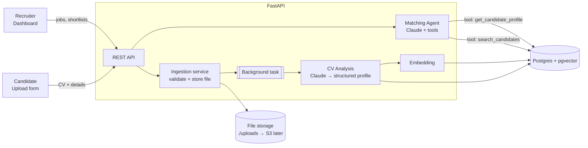

# Entrostic — Architecture

## 1. Requirements

### Functional (MVP)
| # | Requirement | Actor |
|---|---|---|
| F1 | Candidate uploads a CV (PDF/DOCX) with name + email via a web form | Candidate |
| F2 | System extracts text and uses AI to build a structured profile (skills, experience, education, seniority, summary) | System |
| F3 | Profiles are stored and searchable | System |
| F4 | Recruiter creates job openings (title, description, must-have / nice-to-have skills) | Recruiter |
| F5 | System ranks candidates for a job with a score **and a written justification** | System / AI agent |
| F6 | Recruiter views ranked shortlist and candidate details | Recruiter |

### Non-functional
- **Explainable matching** — every score has reasons a recruiter can read and challenge.
- **Privacy** — CVs are personal data (GDPR): store minimal data, support deletion, never log CV contents.
- **Async-friendly** — CV analysis takes seconds; uploads must not block on it (status: `pending → processed | failed`).
- **Replaceable parts** — parser, LLM, and embedding provider sit behind service interfaces.

### Out of scope for the MVP
Auth/multi-tenant, interview scheduling, email outreach, ATS integrations, bias auditing dashboard. (Designed to be addable.)

## 2. Technology stack

| Layer | Choice | Why |
|---|---|---|
| Backend API | **Python 3.13 + FastAPI** | Async, typed, auto OpenAPI docs; best Python ecosystem for docs + AI |
| ORM / migrations | SQLAlchemy 2 + Alembic | Mature, explicit, supports pgvector |
| Database | **PostgreSQL 17 + pgvector** | Relational data and vector similarity in one store |
| CV parsing | Claude native PDF input; `python-docx` for DOCX | Claude reads PDFs (incl. layout) directly — no fragile OCR step |
| AI | **Claude (`claude-opus-5-5`)** via `anthropic` SDK | Structured outputs for profile extraction; tool use for the matching agent |
| Background work | FastAPI `BackgroundTasks` → (later) Celery/RQ + Redis | Start simple, swap when volume grows |
| Frontend | **Next.js (React, TypeScript)** + Tailwind | Candidate upload form + recruiter dashboard |
| Infra | Docker Compose (local) | One command to bring up the DB |

## 3. System architecture



### Where the "agentic" part lives
1. **CV Analysis** — a single, deterministic Claude call with a JSON schema (structured output). Not an agent: the task is well-specified.
2. **Matching Agent** — the genuinely agentic step. Two-stage:
   - *Retrieve*: pgvector similarity search narrows hundreds of candidates to a top-N.
   - *Reason*: Claude, given tools (`search_candidates`, `get_candidate_profile`), evaluates the shortlist against must-have requirements, can broaden the search if too few qualify, and returns a ranked list with per-candidate scores and justifications.

This keeps cost predictable (the LLM never reads the entire database) while allowing judgment that pure vector similarity can't provide (e.g. "5 years of Django" ≈ "Python backend senior").

## 4. Data model (initial)

```
candidates      id, full_name, email, status, created_at
cv_documents    id, candidate_id → candidates, filename, mime_type, storage_path, raw_text
candidate_profiles
                candidate_id → candidates, summary, skills[] , years_experience,
                seniority, education (jsonb), experience (jsonb), embedding vector
jobs            id, title, description, must_have[], nice_to_have[], embedding vector
match_results   id, job_id, candidate_id, score, reasoning, created_at
```

## 5. Project layout

```
Entrostic/
├── docker-compose.yml        # Postgres + pgvector
├── db/init/                  # SQL run on first DB start (enables pgvector)
├── .env.example              # copy to .env
├── docs/ARCHITECTURE.md
├── backend/
│   ├── requirements.txt
│   ├── app/
│   │   ├── main.py           # FastAPI app, CORS, router wiring
│   │   ├── core/config.py    # settings from .env
│   │   ├── db/session.py     # engine, session, Base
│   │   ├── api/routes/       # HTTP endpoints (thin)
│   │   ├── models/           # SQLAlchemy ORM models
│   │   ├── schemas/          # Pydantic request/response + AI output schemas
│   │   ├── services/         # cv parsing, profile extraction, embeddings
│   │   └── agents/           # matching agent + its tools
│   └── tests/
└── frontend/                 # Next.js app (Step 5)
```

## 6. Roadmap

| Step | Deliverable | Status |
|---|---|---|
| 1 | Project skeleton, DB in Docker, FastAPI health check | ✅ |
| 2 | Data models + migrations; CV upload endpoint (store file + candidate) | ✅ |
| 3 | AI CV analysis → structured profile (Claude structured output) | ✅ |
| 4a | Multi-tenant: companies, recruiter auth, admin approval, jobs + share links, applications, redesigned UI | ✅ |
| 4b | Matching agent: rank a job's applicants with scores + reasons | ⏳ |
| 5 | Next.js frontend: upload form + recruiter dashboard | |
| 6 | Hardening: queue, auth, deletion/GDPR, evals for match quality | |
